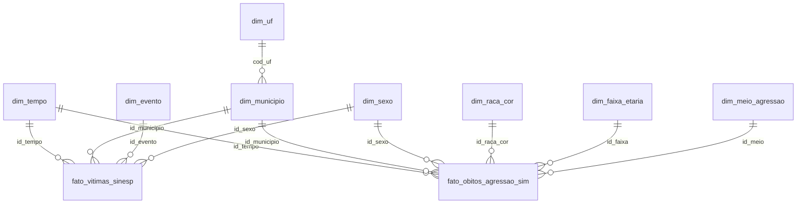

# Fase 2 — Unificação, Tratamento, Modelagem e Armazenamento dos Dados

**Tema:** Monitoramento de Segurança Pública e Feminicídio Interseccional
**Fontes:** SINESP-VDE/MJSP (vítimas por gênero) + SIM/DataSUS (óbitos por agressão com raça/cor) + IBGE (municípios)
**Banco:** PostgreSQL no Aiven (Free Tier, 1 GB) — schema `vde`

Esta fase dá sequência às decisões da Fase 1: recorte 2019–2024, filtro na ingestão (CID-10 X85–Y09 e sexo feminino no SIM), agregação prévia no ETL e leitura em blocos (*chunks*).

---

## Como executar

```bash
pip install -r requirements.txt
cp .env.example .env                 # cole a Service URI do Aiven em DATABASE_URL
python run_pipeline.py               # baixa IBGE + SINESP + SIM (~2,6 GB), trata, carrega e gera docs/relatorio_tratamento.md
python -m scripts.verificar_banco    # roda sql/03_verificacao.sql e grava docs/verificacao_banco.md
python -m pytest -q tests            # testes das regras de tratamento
```

Opções: `--sem-download` (usa só o que já está em `data/raw/`) e `--sem-banco` (trata e gera os CSVs tratados sem carregar).
A carga é **idempotente**: recria o schema e recarrega tudo numa única transação. Se algo falhar, o banco volta ao estado anterior.

## Estrutura do repositório

```
├── run_pipeline.py            orquestra extração → tratamento → carga → relatório
├── etl/
│   ├── config.py              TODAS as decisões de recorte (anos, eventos, CIDs, aliases)
│   ├── extract.py             download (IBGE, SINESP, SIM) + extração dos ZIPs + manifesto SHA-256
│   ├── dimensoes.py           dimensões estáticas + municípios via API IBGE (JSON)
│   ├── transform_sinesp.py    tratamento da SINESP-VDE
│   ├── transform_sim.py       tratamento do SIM em chunks
│   ├── load.py                criação do schema e carga via COPY
│   └── utils.py               normalização de texto e números em formato BR
├── sql/
│   ├── 01_schema.sql          modelo dimensional (DDL)
│   ├── 02_views.sql           visões analíticas para a Fase 3
│   └── 03_verificacao.sql     consultas de evidência (contagens, tamanho, tipos, FKs)
├── scripts/
│   ├── padronizar_sim.py      atalho para etl/padronizar_sim.py (SIM 2022/2023 publicados sem cabeçalho)
│   ├── verificar_banco.py     executa sql/03_verificacao.sql sem precisar de psql
│   └── finalizar_entrega.ps1  carga no Aiven → evidências → documento DOCX/PDF em Downloads
├── tests/                     dados sintéticos no formato das fontes + testes (pytest)
├── data/raw/                  versão ORIGINAL (fora do git) + manifest.json (dentro)
├── data/processed/            versão TRATADA em CSV (uma tabela por arquivo)
└── docs/relatorio_tratamento.md   gerado a cada execução, com os números reais
```

---

## Entregável 1 — Base de dados tratada

| O que o barema pede | Onde está |
|---|---|
| Origem dos dados | Tabela abaixo + `etl/config.py` (URLs) |
| Versão original utilizada | `data/raw/manifest.json` (arquivo, tamanho, SHA-256, data) e tabela `vde.meta_carga` |
| Versão resultante | `data/processed/*.csv` e as tabelas do schema `vde` |
| Decisões e justificativas | Seções abaixo + rastro linha a linha em `docs/relatorio_tratamento.md` |

### Origem

| Fonte | Conteúdo | Formato | Acesso |
|---|---|---|---|
| SINESP-VDE (MJSP) | Vítimas por UF, município, mês e evento, com quebra por sexo | XLSX (um por ano) | Download automático de `https://www.gov.br/mj/pt-br/assuntos/sua-seguranca/seguranca-publica/estatistica/download/dnsp-base-de-dados/bancovde-<ano>.xlsx/@@download/file` (o antigo dados.mj.gov.br saiu do ar) |
| SIM (DataSUS) | Uma linha por Declaração de Óbito | CSV `;` (2019–2020) e CSV em ZIP (2021–2024) | Download automático (links em `SIM_FONTES`, `etl/config.py`). 2022 e 2023 vêm sem cabeçalho e são padronizados por `etl/padronizar_sim.py`; o ZIP oficial fica registrado na `meta_carga` |
| IBGE Localidades | Código e nome dos 5.571 municípios | JSON (API REST) | Download automático |

A SINESP traz **gênero** mas não traz **raça/cor**. O SIM traz raça/cor. Por isso a base tratada une as duas fontes por dimensões compartilhadas. É isso que torna possível a análise interseccional (ODS 5 + ODS 18).

### Decisões de tratamento — SINESP-VDE

| # | Problema encontrado na origem | Decisão | Justificativa |
|---|---|---|---|
| 1 | Nomes de coluna variam entre anos/arquivos | Normalização (minúsculas, sem acento, `_`) e validação das colunas obrigatórias | Pipeline não quebra com mudança de layout e falha cedo se faltar campo essencial |
| 2 | `data_referencia` chega como data, texto `MM/AAAA` ou separada em ano/mês | Conversão para `DATE` no dia 01 | Grão mensal único para as duas fontes |
| 3 | 31 indicadores, a maioria fora do tema (apreensão de drogas, roubo de carga…) | Mantidos 8 eventos de violência contra a pessoa (`EVENTOS` em config) | Foco no tema e menos volume. A comparação ignora acento e caixa ("FEMINICIDIO" = "Feminicídio") |
| 4 | Contagens como texto com separador de milhar (`"1.050"`) | `inteiro_br()`: remove o `.` de milhar, troca a `,` decimal e converte para `INTEGER` | Equivale ao "string monetária → decimal" do guia, aplicado ao nosso tema |
| 5 | Linhas com `total_vitima` > 0 e sexo vazio | Total atribuído a "Não informado" | Não perde vítimas e não inventa sexo |
| 6 | Soma por sexo ≠ `total_vitima` | Mantida a quebra por sexo; ocorrências contadas no relatório | Gênero é o eixo de análise; a divergência fica documentada |
| 7 | Linhas repetidas | Removida só a mesma linha repetida em **outro arquivo**; linhas iguais no mesmo arquivo são mantidas e somadas | O DF informa uma linha por Região Administrativa, todas como "BRASÍLIA": removê-las apagava ~60% das vítimas do DF. Fora do DF, as repetições têm zero vítimas |
| 8 | Município identificado só pelo **nome** | Junção com o IBGE por nome normalizado (sem acento/apóstrofo/espaço) + tabela de aliases (ex.: Embu → Embu das Artes) | Gera o código IBGE, que é a chave para cruzar com o SIM |
| 9 | Nome sem correspondência ou "Não informado" | Vai para a linha "NÃO INFORMADO" da UF; nomes listados no relatório | Preserva o total estadual; a lista orienta novos aliases |
| 10 | Colunas `agente`, `arma`, `faixa_etaria`, `total_peso` | Descartadas | Detalham outros indicadores (apreensões, mortes de agentes). O relatório mostra quantas linhas do escopo têm essas colunas preenchidas, como evidência do descarte |
| 11 | Formato largo (`feminino`, `masculino`, `nao_informado`) | *Unpivot* para uma linha por sexo | Sexo vira dimensão, igual no SIM, e as duas fontes ficam comparáveis |

### Decisões de tratamento — SIM/DataSUS

| # | Problema encontrado na origem | Decisão | Justificativa |
|---|---|---|---|
| 1 | ~1,5 milhão de linhas/ano, 80+ colunas | Leitura de só 6 colunas, em blocos de 200 mil linhas, cada bloco agregado antes de seguir | Memória constante e base final muito abaixo de 1 GB |
| 2 | Inclui todas as causas de morte | Filtro `CAUSABAS` X85–Y09 por expressão regular (agressões) e `SEXO` feminino (`2` ou `F`) | Recorte da Fase 1. A regex não aceita códigos truncados como "X9" |
| 3 | `DTOBITO` como `DDMMAAAA` e, às vezes, sem o zero à esquerda (`1032019`) | Lida como texto, completada com zeros e convertida para `DATE` | Sem isso, óbitos de dias 1 a 9 viram datas inválidas |
| 4 | `IDADE` codificada (1º dígito = unidade: 0 min, 1 h, 2 dias, 3 meses, 4 anos, 5 = 100+) | Unidades 0–3 = 0 anos; vazio e 999 = ignorada; agrupada em 9 faixas | Faixa etária é o terceiro eixo interseccional |
| 5 | `RACACOR` vazio ou fora do domínio | Mapeado para 9 = Ignorada; flag `negra` = preta + parda | Segue o critério IBGE/FBSP; ignorados ficam visíveis em vez de sumir |
| 6 | `CAUSABAS` com 4 caracteres (X954) | Agrupada pelo meio da agressão (arma de fogo, cortante, …) | Dimensão analítica útil e de baixa cardinalidade |
| 7 | `CODMUNOCOR` com 6 dígitos (sem dígito verificador) | Junção com `cod_ibge // 10`; sem correspondência → "NÃO INFORMADO" da UF (2 primeiros dígitos); sem UF válida → descarte contado | Usa o município de **ocorrência** (comparável ao registro policial da SINESP) |

---

## Entregável 2 — Processo de tratamento

O processo é um ETL em Python (pandas) em três camadas, uma por módulo:

1. **Extração** (`extract.py`): baixa as três fontes dos links oficiais, extrai os ZIPs do SIM (padronizando 2022/2023) e grava `manifest.json` com o SHA-256 de cada arquivo. Os arquivos oficiais nunca são alterados.
2. **Tratamento** (`transform_sinesp.py`, `transform_sim.py`, `dimensoes.py`): aplica as regras das tabelas acima. Cada etapa registra quantas linhas entraram e saíram.
3. **Carga** (`load.py`): executa o DDL e carrega com `COPY`, o método mais rápido do PostgreSQL, numa transação única.

**Decisões técnicas e justificativas**

- **Python + pandas:** cobre CSV, XLSX, JSON e Parquet com a mesma API e tem leitura em *chunks* nativa, que o SIM exige.
- **Agregar antes de carregar** (não carregar óbito individual): o tema pede contagens e taxas, não registros nominais. Isso reduz milhões de linhas a milhares e evita guardar dados pessoais sensíveis sem necessidade.
- **Parâmetros centralizados em `config.py`:** mudar o recorte (anos, eventos, CIDs) não exige mexer na lógica.
- **Testes automatizados:** `tests/gerar_fixtures.py` cria arquivos no formato real com os defeitos típicos (milhar em texto, duplicata, data sem zero, sexo `F`/`2`, município inexistente, UF inválida). `pytest` confere cada regra e os totais.
- **Rastreabilidade:** `docs/relatorio_tratamento.md` é regenerado a cada execução com o antes/depois de cada etapa, e a tabela `meta_carga` guarda o hash da versão original dentro do próprio banco.

---

## Entregável 3 — Base armazenada no banco

### Estratégia de modelagem: esquema estrela com duas tabelas fato



**Por que estrela:** a finalidade é analítica (KPIs e dashboards na Fase 3). A estrela deixa as consultas com poucos *joins*, simples de ler e rápidas.
**Por que duas fatos:** as fontes têm grãos e medidas diferentes. A SINESP tem evento × sexo; o SIM tem raça × idade × meio. Forçar uma tabela única criaria colunas vazias e somas erradas.
**Dimensões conformadas** (`dim_tempo`, `dim_municipio`/`dim_uf`, `dim_sexo`): são compartilhadas pelas duas fatos e permitem cruzá-las sem misturar os dados. A visão `vw_comparativo_uf_ano` coloca, no grão UF × ano, feminicídios (SINESP) ao lado dos óbitos de mulheres negras por agressão (SIM).

### Tabelas, campos e tipos

| Tabela | Campos (tipo) | Chave |
|---|---|---|
| `dim_tempo` | id_tempo (INTEGER, AAAAMM), ano, mes, trimestre (SMALLINT), data_referencia (DATE) | PK id_tempo |
| `dim_uf` | cod_uf (SMALLINT), sigla (CHAR 2), nome, regiao (VARCHAR) | PK cod_uf |
| `dim_municipio` | id_municipio (SERIAL), cod_ibge (INTEGER, único), nome, nome_normalizado (VARCHAR), cod_uf (SMALLINT) | PK id_municipio, FK → dim_uf |
| `dim_sexo` | id_sexo (SMALLINT), codigo (CHAR 1), descricao | PK id_sexo |
| `dim_raca_cor` | id_raca_cor (SMALLINT), descricao (VARCHAR), negra (BOOLEAN) | PK id_raca_cor |
| `dim_faixa_etaria` | id_faixa (SMALLINT), descricao, idade_min, idade_max (SMALLINT) | PK id_faixa |
| `dim_evento` | id_evento (SMALLINT), nome, grupo (VARCHAR), violencia_genero (BOOLEAN) | PK id_evento |
| `dim_meio_agressao` | id_meio (SMALLINT), descricao, cids (VARCHAR) | PK id_meio |
| `fato_vitimas_sinesp` | id_tempo, id_municipio, id_evento, id_sexo (FKs), qt_vitimas (INTEGER > 0) | PK composta das 4 FKs |
| `fato_obitos_agressao_sim` | id_tempo, id_municipio, id_sexo, id_raca_cor, id_faixa, id_meio (FKs), qt_obitos (INTEGER > 0) | PK composta das 6 FKs |
| `meta_carga` | fonte, arquivo, sha256 (CHAR 64), tamanho_bytes, linhas_lidas, linhas_apos_filtro (BIGINT), executado_em (TIMESTAMPTZ) | PK id_carga |

Integridade garantida no banco: FKs em todos os relacionamentos, `CHECK` em mês, ano e quantidades, e `UNIQUE` em códigos naturais (sigla, cod_ibge, data).

### Quantidade de dados armazenados

As contagens por tabela e o espaço ocupado ficam na seção 4 de `docs/relatorio_tratamento.md`, gerado após a carga real. Para evidenciar direto no Aiven, rode `sql/03_verificacao.sql`: ele traz as contagens, o tamanho do schema, os campos/tipos, as FKs e a linhagem.

---

## Notas da execução real (outubro/2026)

- **Windows com Smart App Control:** o `python.exe` do `.venv` e as DLLs de numpy 2.5 / pandas 3.0 foram bloqueados. As versões foram fixadas em `requirements.txt` e o pipeline roda com o Python 3.12 do uv apontando para `.venv/Lib/site-packages` (ver `scripts/finalizar_entrega.ps1`).
- **Aliases adicionados** (6 nomes da SINESP sem par no IBGE → 0): Barão de Monte Alto/MG, Santo Antônio do Leverger/MT, Arês/RN, Açu/RN, São Luiz/RR e Gracho Cardoso/SE.
- **Corrigido após revisão adversarial:** (1) DF por Região Administrativa (ver decisão 7; medição em `docs/impacto_duplicatas.csv`); (2) idade em minutos era classificada como ignorada; (3) filtro de CID por regex; (4) linhagem do ZIP oficial do SIM na `meta_carga`; (5) consulta de tamanho em `03_verificacao.sql` contava índices duas vezes.
- **Granularidade:** estupro e estupro de vulnerável só existem por UF na SINESP (100% em "NÃO INFORMADO" municipal).
